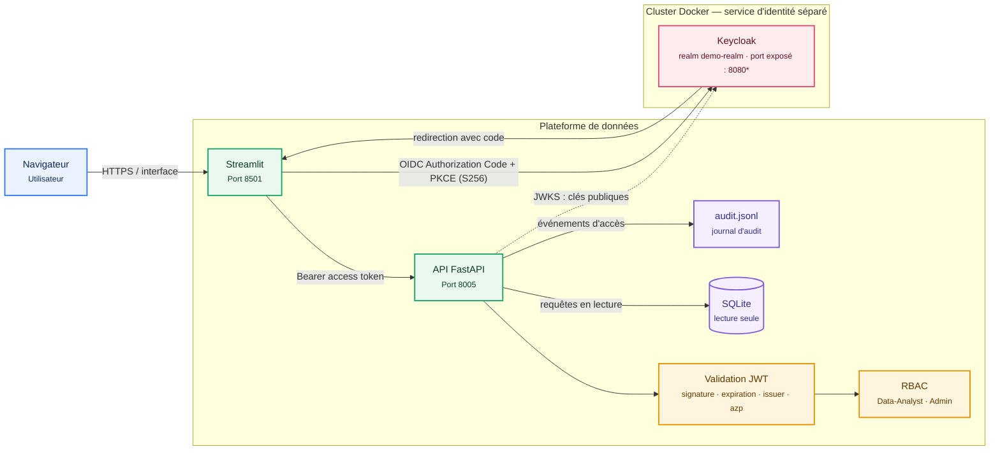
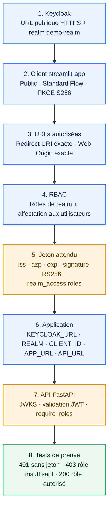

# Streamlit, Keycloak, SSO et RBAC

Ce dépôt contient une démonstration d'une application Streamlit sécurisée par
Keycloak. Keycloak fournit l'authentification OpenID Connect (SSO) et les rôles
métier. Une API FastAPI vérifie les jetons et applique les autorisations côté
serveur avant de donner accès aux données.

## Fonctionnalités

- Connexion Keycloak avec le flux OpenID Connect Authorization Code et PKCE
  (méthode `S256`).
- Contrôle des jetons d'accès par l'API : signature RS256, expiration, émetteur
  (`issuer`) et client autorisé (`azp`).
- Contrôle d'accès basé sur les rôles Keycloak du realm :

  | Rôle | Accès |
  | --- | --- |
  | `Data-Analyst` | Profil et extraction filtrée des transactions |
  | `Admin` | Profil, extraction et consultation du journal d'audit |
  | Aucun rôle métier | Profil uniquement |

- Extraction de données SQLite avec filtres, export CSV et empreinte SHA-256 du
  résultat.
- Journal d'audit au format JSON Lines pour les extractions, les accès refusés
  et les échecs d'authentification.

Le masquage des onglets dans Streamlit améliore l'expérience utilisateur, mais
ne constitue pas une protection : les rôles sont également contrôlés dans l'API.
La base est ouverte en lecture seule par celle-ci.

## Architecture



\* Remplacez `8080` par le port réellement publié par votre cluster Docker.
Keycloak est déployé et configuré séparément du dépôt, mais doit être joignable
à la fois depuis le navigateur (connexion OIDC) et depuis l'API (récupération
des clés JWKS). En production, exposez-le en HTTPS et configurez les URL de
redirection Streamlit avec l'URL publique exacte.

## Prérequis

- Python 3.14 ou plus récent.
- [uv](https://docs.astral.sh/uv/).
- Une instance Keycloak accessible depuis le navigateur et l'API.
- Un realm, un client et les rôles configurés comme décrit ci-dessous.

## Configuration de Keycloak

Les valeurs par défaut de l'application sont :

- URL Keycloak : `http://127.0.0.1:8080`
- Realm : `demo-realm`
- Client : `streamlit-app`
- URL de redirection Streamlit : `http://127.0.0.1:8501/`

Dans Keycloak :

1. Créez le realm `demo-realm`.
2. Créez le client `streamlit-app` comme client public (l'authentification du
   client est désactivée) et activez le flux **Standard flow**.
3. Configurez l'URL de redirection valide à
   `http://127.0.0.1:8501/`. Pour un autre hôte ou port, adaptez les URLs
   ci-dessous et la configuration Keycloak. En production, limitez les
   redirections aux URLs réellement utilisées.
4. Configurez PKCE avec la méthode `S256` pour le flux Authorization Code.
5. Créez les rôles de realm `Data-Analyst` et `Admin`, puis attribuez-les aux
   utilisateurs de démonstration.

L'API lit les rôles depuis `realm_access.roles` et n'autorise que les jetons
dont `azp` correspond à `streamlit-app`. L'URL d'émetteur attendue est
`<KEYCLOAK_URL>/realms/<KEYCLOAK_REALM>`.

## Comprendre SSO et RBAC

**SSO (Single Sign-On)** répond à la question *« qui est cet utilisateur ? »*.
Keycloak centralise sa connexion : l'application ne manipule jamais son mot de
passe. Streamlit redirige le navigateur vers Keycloak, reçoit un code à usage
unique, puis l'échange contre un jeton d'accès. Le mécanisme PKCE lie ce code à
la tentative de connexion initiale et protège l'échange pour un client public.

**RBAC (Role-Based Access Control)** répond à la question *« qu'a-t-il le droit
de faire ? »*. Keycloak ajoute les rôles du realm dans le jeton (`realm_access.roles`).
FastAPI vérifie le jeton puis applique les permissions côté serveur ; masquer un
bouton dans Streamlit n'est donc jamais une autorisation.

| Rôle attribué dans Keycloak | Routes FastAPI autorisées |
| --- | --- |
| Aucun rôle métier | `/me` uniquement |
| `Data-Analyst` | `/me`, `/extract` |
| `Admin` | `/me`, `/extract`, `/audit/logs` |

## Schéma strict : configuration et contrôles



Suivez cette séquence sans sauter d'étape. Un contrôle qui échoue doit être
corrigé avant de poursuivre : cela évite de diagnostiquer un problème RBAC qui
est en réalité une URL de redirection ou un émetteur JWT incorrect.

| Étape | À configurer | À vérifier avant de continuer |
| --- | --- | --- |
| 1. Serveur Keycloak | Une URL accessible par le navigateur **et** FastAPI ; realm `demo-realm`. | Ouvrir `<KEYCLOAK_URL>/realms/demo-realm/.well-known/openid-configuration` : réponse JSON et champ `issuer` égal à `<KEYCLOAK_URL>/realms/demo-realm`. |
| 2. Client OIDC | Client `streamlit-app`, type **public** (Client authentication désactivée), **Standard flow** activé, Implicit flow et Direct access grants désactivés, PKCE `S256`. | Le client n'a pas de secret dans le dépôt et l'endpoint `authorization_endpoint` est visible dans la configuration OIDC. |
| 3. URLs du client | `Valid redirect URIs` = URL publique exacte de Streamlit, p. ex. `https://app.exemple.fr/` ; `Web origins` = même origine. | Après connexion, le navigateur revient exactement sur `APP_URL`, sans erreur `Invalid redirect_uri`. Évitez `*` en production. |
| 4. Rôles et utilisateurs | Créer les rôles de **realm** `Data-Analyst` et `Admin`, puis les attribuer aux utilisateurs ou groupes de test. Pour le client, désactiver *Full Scope Allowed* et n'autoriser que les rôles nécessaires. | Connexion avec trois comptes : sans rôle, analyste, administrateur. Les rôles sont bien affectés dans Keycloak et seuls les rôles autorisés sont émis pour ce client. |
| 5. Jeton | Le mapper de rôles de realm doit inclure les rôles dans l'**access token**. | Décoder un jeton de test : `iss` attendu, `azp: "streamlit-app"`, `exp` futur, `realm_access.roles` présent. Ne partagez jamais le jeton. |
| 6. Variables d'environnement | Même base URL et realm côté Streamlit et API. `APP_URL` doit être identique à la redirection déclarée à l'étape 3. | `KEYCLOAK_URL`, `KEYCLOAK_REALM`, `KEYCLOAK_CLIENT_ID`, `APP_URL` et `API_URL` correspondent aux URLs réellement publiées, sans confusion entre `localhost` et nom Docker. |
| 7. API | `issuer` = `<KEYCLOAK_URL>/realms/<KEYCLOAK_REALM>` ; JWKS = `<issuer>/protocol/openid-connect/certs` ; règles `require_roles`. | Depuis le processus FastAPI, l'URL JWKS répond. L'API valide signature RS256, expiration, issuer et `azp` avant de lire les rôles. |
| 8. Preuve RBAC | Exécuter les essais ci-dessous et consulter `logs/audit.jsonl`. | Résultats 401 / 403 / 200 conformes ; les échecs et extractions sont journalisés. |

### Tests d'acceptation RBAC

1. Sans en-tête `Authorization`, appeler `GET /me` : résultat attendu **401**.
2. Avec un utilisateur sans rôle métier, appeler `GET /extract` : résultat attendu **403**.
3. Avec `Data-Analyst`, appeler `GET /extract` : résultat attendu **200** ; appeler `GET /audit/logs` : **403**.
4. Avec `Admin`, appeler `GET /extract` et `GET /audit/logs` : résultat attendu **200**.
5. Vérifier dans `logs/audit.jsonl` les événements `AUTH_FAILED`, `ACCESS_DENIED` et `DATA_EXTRACTION` correspondant aux essais.

> Si Keycloak est dans Docker, `127.0.0.1` ne désigne pas toujours le même
> hôte selon l'endroit où tourne Streamlit ou FastAPI. Utilisez une URL unique,
> résoluble depuis le navigateur et les services (`https://keycloak.exemple.fr`
> en production est le plus simple), puis configurez exactement cette valeur
> dans Keycloak et dans `KEYCLOAK_URL`.

## Installation et lancement

Depuis la racine du dépôt, installez les dépendances verrouillées :

```powershell
uv sync
```

La base de démonstration `data/business.db` est déjà présente. Si elle est
absente, elle peut être générée avec des données synthétiques :

```powershell
uv run python -m scripts.init_db
```

> **Attention :** ce script recrée la base configurée et supprime le fichier
> existant avant de générer les données.

Lancez l'API dans un premier terminal :

```powershell
uv run uvicorn backend.main:app --reload --host 127.0.0.1 --port 8005
```

Lancez Streamlit dans un second terminal :

```powershell
uv run streamlit run frontend/app.py --server.address 127.0.0.1 --server.port 8501
```

Ouvrez ensuite `http://127.0.0.1:8501/` et connectez-vous avec un utilisateur
Keycloak auquel un rôle a été attribué. L'API est documentée automatiquement à
`http://127.0.0.1:8005/docs`.

## Variables d'environnement

Les valeurs peuvent être définies dans un fichier `.env` à la racine ou dans
l'environnement du processus. Les variables utilisées et leurs valeurs par
défaut sont :

| Variable | Valeur par défaut | Utilisée par |
| --- | --- | --- |
| `KEYCLOAK_URL` | `http://127.0.0.1:8080` | Streamlit et API |
| `KEYCLOAK_REALM` | `demo-realm` | Streamlit et API |
| `KEYCLOAK_CLIENT_ID` | `streamlit-app` | Streamlit et API |
| `APP_URL` | `http://127.0.0.1:8501/` | URL de retour OIDC de Streamlit |
| `API_URL` | `http://127.0.0.1:8005` | URL de l'API appelée par Streamlit |
| `DB_PATH` | `data/business.db` | Chemin de la base SQLite de l'API |
| `AUDIT_LOG_PATH` | `logs/audit.jsonl` | Chemin du journal d'audit de l'API |

Exemple pour modifier les valeurs locales (à adapter à votre environnement) :

```dotenv
KEYCLOAK_URL=http://127.0.0.1:8080
KEYCLOAK_REALM=demo-realm
KEYCLOAK_CLIENT_ID=streamlit-app
APP_URL=http://127.0.0.1:8501/
API_URL=http://127.0.0.1:8005
DB_PATH=data/business.db
AUDIT_LOG_PATH=logs/audit.jsonl
```

Ne placez aucun secret ou donnée sensible dans un fichier versionné. Utilisez
des variables d'environnement sécurisées pour les déploiements.

## Endpoints de l'API

| Méthode et route | Autorisation | Description |
| --- | --- | --- |
| `GET /health` | Publique | Vérification de disponibilité |
| `GET /me` | Tout utilisateur authentifié | Identité et rôles du jeton |
| `GET /extract` | `Data-Analyst` ou `Admin` | Extraction filtrée des transactions |
| `GET /audit/logs` | `Admin` | Dernières entrées du journal d'audit |

Les filtres d'extraction comprennent le pays, la catégorie, le statut, une plage
de dates, les montants minimum et maximum, ainsi qu'une limite de lignes.

## Structure du dépôt

```text
backend/             API FastAPI, validation JWT, RBAC, données et audit
frontend/app.py      Application Streamlit avec connexion Keycloak
data/business.db     Base SQLite de démonstration
logs/audit.jsonl     Journal d'audit JSON Lines
scripts/init_db.py   Génération de transactions synthétiques
main.py              Tableau de bord Kubernetes distinct de l'application SSO
```

`main.py` correspond à un visualiseur de pods Kubernetes distinct ; il n'est pas
le point d'entrée de la plateforme Streamlit protégée par Keycloak décrite
ci-dessus.
